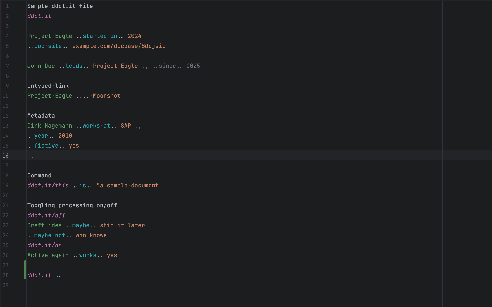
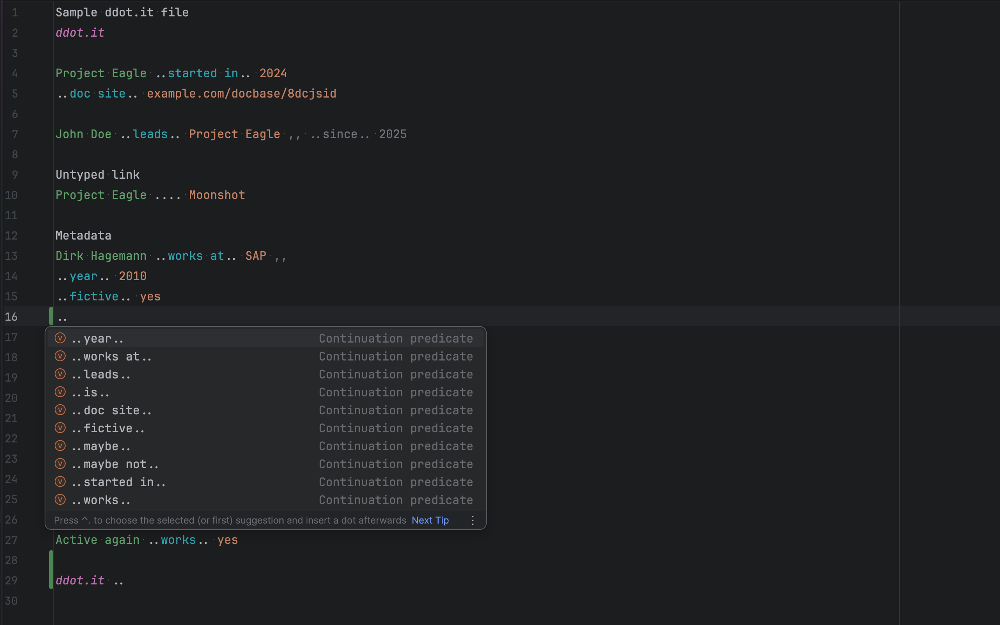
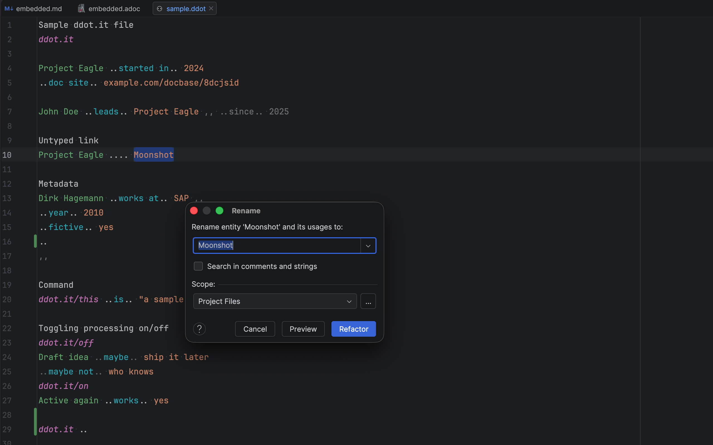
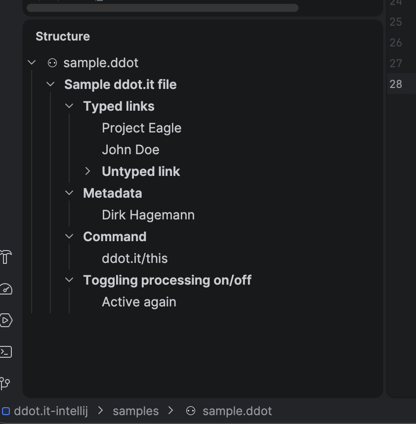
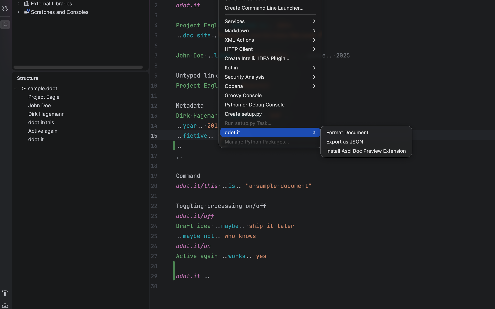
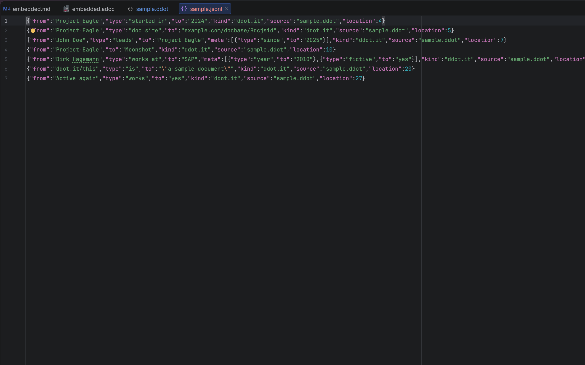
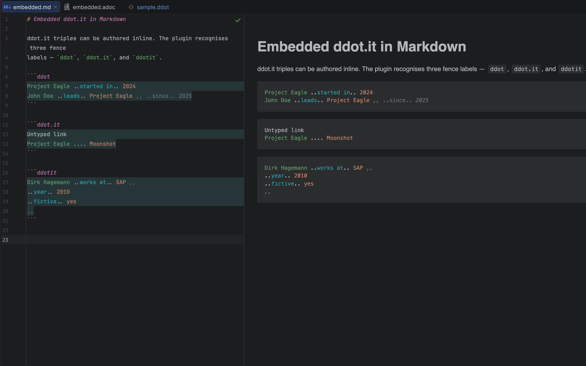
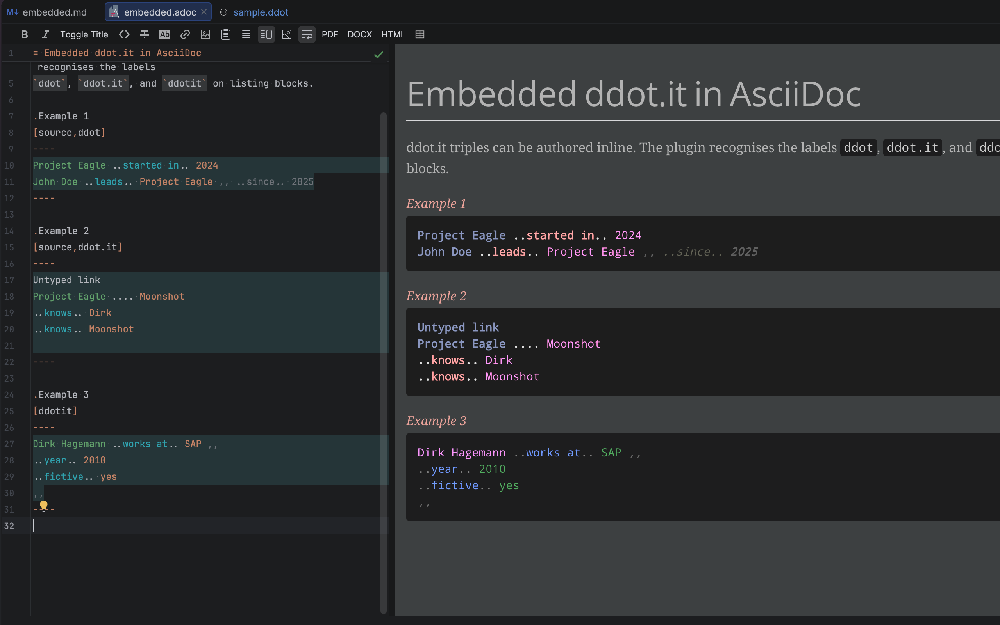

= ddot.it for IntelliJ IDEA — User Guide
:toc:
:toclevels: 3
:icons: font
:experimental:
:source-highlighter: rouge
:url-ddot: https://ddot.it
:url-events: https://ddot.it/developer-guide.html#events
:url-asciidoc-plugin: https://plugins.jetbrains.com/plugin/7391-asciidoc
:url-syntax-tools: https://github.com/Calpano/ddot.it-syntax-tools

This guide covers everything the ddot.it plugin does in IntelliJ IDEA, feature by feature.
For a one-page overview, see xref:README.adoc[the README].

link:{url-ddot}[ddot.it] is a minimal text format for typed knowledge graphs.
Each line is a triple — `subject ..predicate.. object` — written with double-dot separators.

[[install]]
== Installation

The plugin targets IntelliJ IDEA 2026.2 (build 262).

.Install options
* *From the Marketplace* — _Settings → Plugins → Marketplace_, search for _ddot.it_.
* *From a zip* — see <<build>>, then _Settings → Plugins → ⚙ → Install Plugin from Disk…_ and pick the zip.

Once installed, any file with the `.ddot` extension opens in the ddot.it editor.
ddot blocks inside Markdown and AsciiDoc files get the same editor support, see <<embedded>>.

[[format]]
== The ddot.it format in one minute

ddot.it is a line-oriented graph notation built around two separators.

.Separators
`..`:: typed link — `subject ..predicate.. object`
`....`:: simple (untyped) link — `subject .... object`

Continuations and metadata extend a triple without repeating the subject:

[source,ddot]
----
Project Eagle ..started in.. 2024
..doc site.. example.com/docbase/8dcjsid

John Doe ..leads.. Project Eagle ,, ..since.. 2025

Project Eagle .... Moonshot

Dirk Hagemann ..works at.. SAP ,,
..year.. 2010
..fictive.. yes
,,
----

Lines starting with `..` continue the previous subject.
`,,` opens metadata; a closing `,,` ends a multi-line metadata block.
Lines without separators are free text: titles, notes and section headings.

Commands toggle processing for parts of a file.
Everything between `ddot.it/off` and `ddot.it/on` (or the short forms `!!off` and `!!on`) is excluded from the graph:

[source,ddot]
----
ddot.it/off
Draft idea ..maybe.. ship it later
ddot.it/on
Active again ..works.. yes
----

For the full format spec and the canonical event JSON shape, see the link:{url-events}[ddot.it Developer Guide → Events].

[[editing]]
== Editing

[[highlighting]]
=== Syntax highlighting

Subjects, predicates, objects, metadata and commands each get their own color.
Lines that are excluded by `ddot.it/off` are dimmed.

Adjust the colors under _Settings → Editor → Color Scheme → ddot.it_.

The editor warns about an incomplete triple whose object slot is empty, such as `Alice ..knows..`.
The JSON export would otherwise drop such a line silently.



[[completion]]
=== Smart completion

Completion knows which slot of the triple the cursor is in.

.Slot-aware suggestions
* In the subject slot it suggests known subjects.
* In the predicate slot it suggests known predicates.
* In the object slot it suggests known objects.

Suggestions come from the current file and the rest of the project.
For predicates, the ones you used recently rank first, then those in the current file, then the rest of the project.

.Completion behavior
* Multi-word entities, such as `John Doe`, complete as a single unit.
* Suggestions are *prefix-matched* (case-insensitive), not fuzzy.
* Picking a subject auto-inserts `..` and surfaces predicates; picking a predicate auto-inserts `..` and surfaces objects.
* On a fresh line after a complete triple, suggestions open automatically with `..rel..`-form predicates for a continuation.
* When the cursor sits right after `..`, predicates show as `..rel..` items whose range absorbs the existing `..`, so accepting one never doubles the dots.



[[templates]]
=== Live templates

Type a template prefix and press kbd:[Tab].

.Templates
`ddot-typed`:: typed link
`ddot-link`:: simple link
`ddot-property`:: typed link with metadata
`ddot-continue`:: continuation predicate
`ddot-meta`:: metadata pair

[[formatter]]
=== Canonical formatter

_Code → Reformat Code_ (kbd:[⌘+⌥+L] / kbd:[Ctrl+Alt+L]) normalizes spacing around separators.

.Canonical shapes
Typed link:: `subject ..predicate.. object`
Simple link:: `subject .... object`
Continuation:: `..predicate.. object`
Metadata:: `,, content` inline, `,,` at the end of a line

[[rename]]
=== Rename and Find Usages

ddot.it has no declarations: every occurrence of an entity name is equal.

.Refactorings
* *Rename* (kbd:[Shift+F6]) on any entity renames every occurrence of that name in the file.
* *Find Usages* (kbd:[Alt+F7]) lists every occurrence of an entity.



[[docs]]
=== Quick documentation

kbd:[Ctrl+Q] (kbd:[F1] on macOS) on a line shows its shape: typed link, simple link or metadata.

[[navigation]]
== Navigating a file

[[structure-view]]
=== Structure view

The Structure tool window (kbd:[⌘+7] / kbd:[Alt+7]) and the file structure popup (kbd:[⌘+F12] / kbd:[Ctrl+F12]) show an outline of the file.
The outline is built from two things.

.Outline contents
* *Sections* — AsciiDoc-style headings, shown in *bold*.
* *Subjects* — every distinct subject of a triple, listed under the section it appears in.

A section heading is a line that starts with one or more `=`, followed by a space and a title.
The number of `=` sets the level.
The symmetric form `== Title ==` works too.

Sections nest by level.
Missing levels are ignored: a heading simply nests under the nearest preceding heading with fewer `=`.
A line of only `=` characters, such as `====`, has no title and is not a section.

.A file with sections
[source,ddot]
----
Top ..is.. first

= Doc
Alice ..knows.. Bob

== Chapter A
Carol ..likes.. Tea
Carol ..likes.. Coffee

==== Deep
Dave ..owns.. Car

== Chapter B ==
Alice ..knows.. Eve

= Second
----

.Resulting outline
[source,text]
----
Top
Doc                 (bold)
├── Alice
├── Chapter A       (bold)
│   ├── Carol
│   └── Deep        (bold, nested although === is missing)
│       └── Dave
└── Chapter B       (bold)
    └── Alice
Second              (bold)
----

.Rules for subjects
* Subjects before the first heading appear at the top level.
* A subject counts only when its line is a triple, i.e. it has at least one separator.
  Free-text lines such as titles and notes stay out of the outline.
* Each subject appears once per section.
  A subject used in two sections appears under both.
* Headings and subjects inside a `ddot.it/off` region are left out.



Click an entry to jump to it.
The *Sort Alphabetically* toggle in the Structure tool window sorts sections and subjects alike.

[[folding]]
=== Folding

Each run of triple and continuation lines folds as one unit; a blank line ends it.
A `ddot.it/off` … `ddot.it/on` region, including its two command lines, folds as a whole.

[[tools]]
== Tools menu

All actions live under _Tools → ddot.it_.



.Actions
Format Document:: Same as _Code → Reformat Code_, see <<formatter>>.
To Full Triples:: Expands continuation lines by repeating the inherited subject, so every line becomes a self-contained triple.
Metadata blocks and `ddot.it/off` regions are left untouched.
Export as JSON:: Writes one link:{url-events}[triple event] per line (JSONL) next to the source file.
Each event carries the fields `from`, `type`, `to`, `meta`, `kind`, `source` and `location`.
Convert Connected JSON (CJ) to ddot.it:: Generates a sibling `.ddot` file from a `*.cj.json` file.
Also available from the context menu of a `*.cj.json` file in the Project view.
Install AsciiDoc Preview Extension:: Installs the AsciiDoc preview renderer on demand, see <<asciidoc>>.



`*.cj.json` files are recognized as their own _CJ JSON_ file type, with JSON highlighting, structure and completion.

[[embedded]]
== ddot.it inside Markdown and AsciiDoc

ddot.it blocks in Markdown and AsciiDoc files get the same editor support as `.ddot` files: highlighting, completion and formatting of the block body.
Their previews render with the same role-aware coloring as the editor.

Recognized block labels are `ddot`, `ddot.it` and `ddotit`.

[[markdown]]
=== Markdown — zero setup

Open a `.md` file and use a fenced code block.
The bundled JetBrains Markdown plugin is enough; no extra steps.

[source,markdown]
----
```ddot
Project Eagle ..started in.. 2024
..doc site.. example.com/docbase/8dcjsid

John Doe ..leads.. Project Eagle ,, ..since.. 2025
```
----

The preview uses fixed colors tuned for both the light and the dark theme.



[[asciidoc]]
=== AsciiDoc

The link:{url-asciidoc-plugin}[AsciiDoc plugin] has no extension point for third-party preview renderers, and only loads Asciidoctor extensions from `<projectRoot>/.asciidoctor/lib/`.
So the preview ships as an Asciidoctor extension that has to live next to your project — but you don't have to put it there yourself.

.Enabling the AsciiDoc preview
. Install the AsciiDoc plugin if you haven't already, and open your project.
. Open any `.adoc` file that contains a ddot block.
The plugin drops `ddot-render.rb`, `ddot.rb` and `ddot-extension.rb` into `<projectRoot>/.asciidoctor/lib/` and tells you it did.
. The AsciiDoc plugin shows a banner asking to trust the new extension files.
Click *Enable* for all three.
. Open or refresh the AsciiDoc preview.

`ddot.rb` is the link:{url-syntax-tools}[ddot.it-syntax-tools] Rouge lexer, bundled at build time.
It highlights `[source,ddot]` blocks in documents that set `:source-highlighter: rouge`.

Nothing is written into projects that have no ddot blocks, and a plugin upgrade refreshes the installed copies on the next open.
_Tools → ddot.it → Install AsciiDoc Preview Extension_ does the same thing on demand.
Use it to repair a deleted or hand-edited copy, or to install before writing your first ddot block.
To turn the automatic install off, set `ddot.asciidoc.autoinstall` to `false` in _Help → Find Action → Registry_.

After that, `[ddot]` and `[source,ddot]` listing blocks render with role coloring:

[source,asciidoc]
....
[source,ddot]
----
Project Eagle ..started in.. 2024

Dirk Hagemann ..works at.. SAP ,,
..year.. 2010
..fictive.. yes
,,
----
....

The editor support works without the install — only the AsciiDoc _preview rendering_ needs it.

Override the palette per document via AsciiDoc attributes:

[source,asciidoc]
----
:ddot-color-subject: #aa00aa
:ddot-color-predicate: #1750eb
:ddot-color-object: #067d17
----



[[build]]
== Building from source

[source,bash]
----
mvn package
----

The plugin zip is at `target/ddotit-intellij-<version>.zip`.
Install it via _Settings → Plugins → ⚙ → Install Plugin from Disk…_ and pick the zip.
Then open or create a `.ddot` file to try it.
